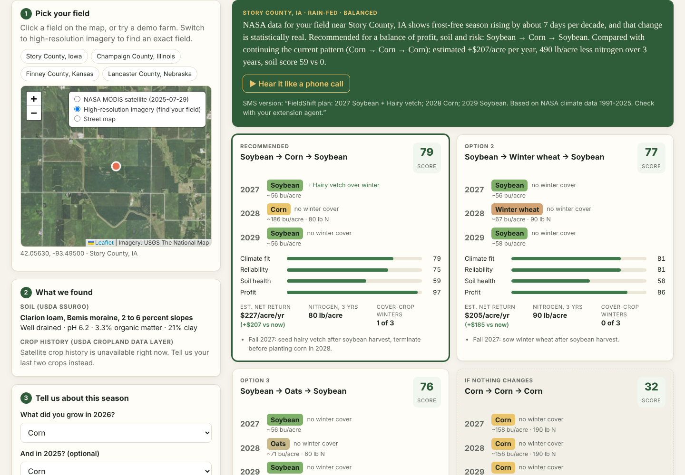

# SoilSense

**Crop rotations for a changing climate, built on NASA Earth observations.**
NASA Space Apps Challenge 2026 · *Field Shift: Adapting Farms with NASA Data*

A farmer picks their field on a map (or calls a phone number). SoilSense then:

1. pulls 35 years of daily NASA climate data for that exact spot,
2. tests which changes are statistically real,
3. reads the field's USDA soil survey and satellite crop history, and
4. tests every reasonable 3-year rotation (with or without winter cover crops) against that weather, soil and the farmer's main goal.

The result is a ranked plan with the reasons behind it, compared against what happens if the farmer changes nothing.



---

## The problem

US row-crop farmers decide every fall what each field grows next year. Most fall back on habit: corn after corn, or the same corn–soybean cycle their parents ran. Meanwhile the climate on their land is shifting. In central Iowa, NASA POWER data shows the frost-free season lengthening by about 7 days per decade since 1991 (Mann-Kendall p = 0.001). NASA measures these changes field by field, but only as APIs and data files a farmer would never open.

The challenge asks for a decision-support tool that combines NASA Earth observations, local soil information, crop characteristics and farmer priorities. The tool should help farmers explore rotations that build soil health and adapt to changing conditions.

## What SoilSense does

| | |
|---|---|
| **Web dashboard** | Pick a field on a NASA MODIS / USGS imagery map. See the soil, satellite crop history, 7 trend-tested climate indicators, the top 3 rotations with scores, and every reason behind the plan. Ask questions about the plan. |
| **Phone line (Twilio)** | No app or internet needed. The caller enters a ZIP code, this year's crop, irrigation and their priority. They hear the plan, can press 1 for the reasons and 2 to get it by SMS. English and Spanish. |
| **Same engine for both** | One `/api/plan` call, so a call and the dashboard always agree. |

## How it works

```
Farmer (phone)  ─►  Twilio Voice/SMS ─┐
                                      ├─►  Cloudflare Worker  ─► Rotation engine (pure TypeScript)
Advisor (web)   ─►  React dashboard ──┘         │                    ├─ climate features + trend tests
                                                │                    ├─ crop stress replay (35 yrs)
                                                ▼                    ├─ ~500–1,300 candidate rotations
                       NASA POWER · USDA SSURGO · USDA CDL           └─ scores, reasons, speech/SMS text
                       FCC county · USDA NASS (opt.) · D1 cache
```

### The engine (`src/engine`)

1. **Climate features** (`climate.ts`). For every year 1991–2025, computes growing-season rain, spring rain, days ≥ 95 °F, frost-free days, growing degree days, the longest summer dry spell and the average summer high. All come from NASA POWER daily data.
2. **Trend tests** (`stats.ts`). Mann-Kendall with tie correction, Sen's slope, plus a lag-1 autocorrelation (effective sample size) correction. A trend counts only if p < 0.05. Verified against `pymannkendall`.
3. **Crop stress replay** (`rotation.ts`). Each crop is checked against every historical year, after shifting that year by any *significant* trend so it reflects today's climate. A crop-year counts as stressed when its combined score falls below 0.6. The score combines:
   - water: rain plus stored soil water (SSURGO available water capacity) plus irrigation, against crop need
   - extreme-heat degree days above the crop's threshold (the measure used by Schlenker & Roberts, PNAS 2009)
   - growing degree days and frost-free season length
   - wet springs that delay planting
   - severe winter cold for fall-sown and perennial crops
4. **Rotations**. Every 3-year sequence of corn, soybean, winter wheat, oats, alfalfa and grain sorghum (where markets exist), with feasible winter cover crops, is checked against agronomic rules:
   - winter wheat only after an early-harvested crop, and only while its sowing window is still open
   - no annual crop three years running
   - alfalfa stands of at least 2 years
   - legume covers only before corn or sorghum

   Each plan gets four 0–1 scores: climate fit, reliability, soil health and profit. They are weighted by the farmer's priority (profit, soil health, lower risk, or balanced).
5. **Explanations** (`explain.ts`). Every sentence is built from computed facts. Nothing is invented. The same facts drive the dashboard, the spoken answer and the SMS.

## Data sources

| Source | Used for |
|---|---|
| [NASA POWER](https://power.larc.nasa.gov/) daily API (MERRA-2 based) | Rain, max/min temperature, frost dates, heat and growing degree days, root-zone soil wetness, 1991 to last year |
| [NASA GIBS](https://gibs.earthdata.nasa.gov/) MODIS Terra true color | Satellite base map |
| [USDA NASS Cropland Data Layer](https://nassgeodata.gmu.edu/CropScape/) | What grew on the field in each of the last 6 years (30 m) |
| [USDA NRCS SSURGO](https://sdmdataaccess.sc.egov.usda.gov/) via Soil Data Access | Soil type, drainage, pH, organic matter, texture, water-holding capacity |
| [USDA NASS Quick Stats](https://quickstats.nass.usda.gov/api) (optional key) | County average yields |
| [FCC Area API](https://geo.fcc.gov/api/census/) | County lookup |
| [USGS The National Map](https://www.usgs.gov/programs/national-geospatial-program/national-map) | High-resolution imagery for finding a field |
| [Zippopotam.us](https://zippopotam.us/) | ZIP code to location for phone calls |

---

## Run it locally

Requires Node 20+.

```bash
npm install
cp .dev.vars.example .dev.vars        # keep TWILIO_VALIDATE=false for local testing
npm run db:migrate:local              # creates the local D1 cache tables
npm run dev:offline                   # builds the dashboard, starts the Worker at http://127.0.0.1:8787
```

Open http://127.0.0.1:8787 and click a demo farm.

- `npm run dev:offline` runs without a Cloudflare login. "Ask about this plan" then answers by matching facts instead of using Workers AI.
- After `npx wrangler login`, `npm run dev` uses the real Workers AI binding.
- For dashboard hot reload, run `npm run dev:offline` in one terminal and `npm run dev:web` in another, then open http://localhost:5173.

### Tests and checks

```bash
npm test            # 41 tests: stats vs pymannkendall, EPSG:5070 projection vs pyproj, Twilio signatures vs twilio-python, engine on real Iowa NASA data, routes
npm run typecheck
```

## Deploy (Cloudflare)

```bash
npx wrangler login
npx wrangler d1 create fieldshift           # paste the database_id into wrangler.jsonc and wrangler.offline.jsonc
npm run db:migrate:remote
npx wrangler secret put TWILIO_ACCOUNT_SID
npx wrangler secret put TWILIO_AUTH_TOKEN
npx wrangler secret put NASS_API_KEY        # optional
npx wrangler secret put ADMIN_TOKEN         # optional, protects GET /api/logs
npm run deploy
node scripts/prefetch-demo.mjs https://soilsense.<your-subdomain>.workers.dev   # warm the cache before a demo
```

### Connect the phone number (Twilio)

1. Buy a Twilio number with Voice and SMS.
2. Under **Voice → A call comes in**, choose Webhook, `POST https://soilsense.<your-subdomain>.workers.dev/voice/incoming`.
3. Call it. Every webhook is checked against Twilio's `X-Twilio-Signature`. If you put a proxy or custom domain in front, set `PUBLIC_BASE_URL` to the URL Twilio uses.

**Call flow:**
1. Language (1 for English, 2 for Spanish)
2. ZIP code (keypad or speech)
3. This year's crop
4. Irrigated?
5. Priority
6. The spoken plan
7. Menu: 1 why, 2 SMS, 3 another option, 9 repeat

## API

| Method | Path | Body / query | Returns |
|---|---|---|---|
| GET | `/api/health` | | Service status |
| GET | `/api/field` | `lat`, `lon` | County, SSURGO soil, CDL crop history |
| POST | `/api/plan` | `{ lat, lon, irrigated, priority: "balanced"\|"profit"\|"soil"\|"risk", recentCrops?: CropId[], language?: "en"\|"es" }` | Full plan: climate indicators with trends, top 3 plans, current-pattern comparison, facts, speech/SMS text, assumptions, sources |
| POST | `/api/ask` | `{ question, planLabel, summary, facts[] }` | Answer grounded only in the plan's facts (Workers AI, with a fact-matching fallback) |
| GET | `/api/logs` | `limit` (Bearer `ADMIN_TOKEN` if set) | Recent plans and calls; phone numbers are masked |
| POST | `/voice/*` | Twilio webhooks | TwiML |

`CropId` is one of `corn`, `soybean`, `winter_wheat`, `oats`, `alfalfa`, `sorghum`.

## Project layout

```
src/engine/      pure, unit-tested logic: climate.ts, stats.ts, crops.ts, regions.ts, rotation.ts, explain.ts, plan.ts
src/worker/      Cloudflare Worker: routes (api, voice), data clients (power, soil, cdl, albers, geo, nass), cache, Twilio
src/shared/      types shared by the API and the dashboard
web/             React + Leaflet dashboard (Vite), served as Worker static assets
migrations/      D1 schema (cache + plan log)
test/            Vitest suites + real NASA POWER fixtures (Iowa, Kansas)
scripts/         prefetch-demo.mjs (cache warming)
```

## Production notes

- **Caching.** Responses are cached in memory and in D1: POWER for 30 days, keyed to its 0.5° × 0.625° grid cell as NASA asks; soil for 90 days; crop history for 180 days. A repeat plan takes about 60 ms; a fresh grid cell takes about 2 s.
- **Resilience.**
  - Every upstream call has a timeout and retry.
  - Soil, crop history, county and NASS lookups degrade gracefully. If one fails, the plan still runs and the UI says what's missing.
  - Crop-history outages are remembered for 10 minutes so they don't slow every request.
  - Voice plans are capped at 12 s to stay inside Twilio's 15 s webhook limit.
- **Security.**
  - Twilio signature validation (constant-time compare) is on by default.
  - Input is validated, and coordinates must be in the contiguous US.
  - Each Worker instance applies a simple rate limit; add Cloudflare rate-limiting rules for hard limits.
  - Phone numbers are stored masked (`***0123`).
  - No secrets live in the repo.
- **Observability.** Structured JSON logs, Workers observability enabled, and a `Server-Timing` header on `/api/plan`.

## Assumptions and limits (please read)

- **Decision support, not a guarantee.** SoilSense does not forecast next season's weather.
- **Economics are indicative.** Prices, costs, base yields, nitrogen rates and rotation effects are approximate defaults in `src/engine/crops.ts` and `src/engine/regions.ts`. An agronomist or extension economist should replace them with local budgets. A USDA NASS key replaces state yields with county averages.
- **Climate data resolution.** NASA POWER is gridded (about 50 km), not a field weather station.
- **Crop history reflects the past.** The CDL comes out once a year, so the farmer confirms this season's crop.
- **Not yet modeled.** Fallow (used in western Great Plains wheat–sorghum–fallow systems), cotton, rice and specialty crops. Sorghum is offered only in states with sorghum markets.
- Review any plan with your county extension agent.

## License

MIT
